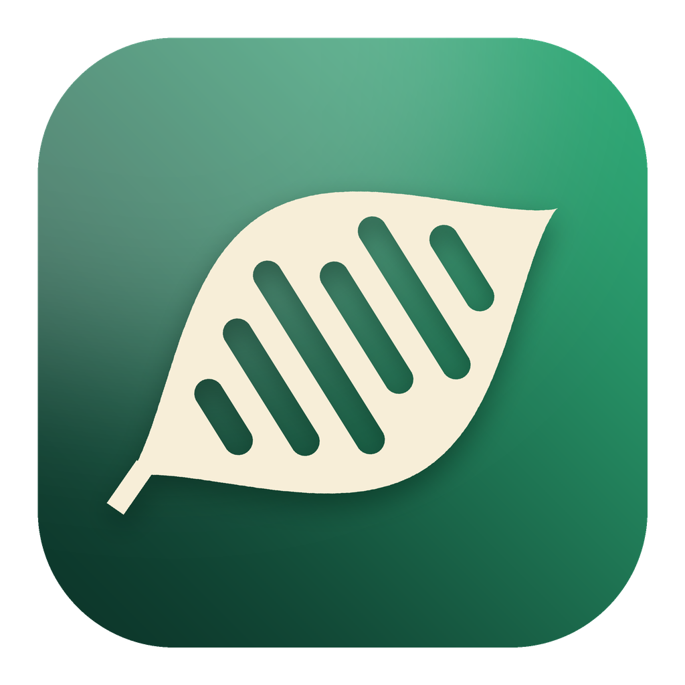

<div align="center">



# Grove

**Meeting notes that listen without joining the call — written on your Mac.**

No bot in the meeting. No transcript in the cloud. Just your rough notes,
turned into good ones, with every line traceable to what was actually said.

<br>

<a href="https://github.com/atharvdesai/grove/releases/latest/download/Grove.dmg"></a>

`brew install --cask atharvdesai/grove/grove`

<sub>macOS 26 or later · Apple Silicon · Free and open source (MIT)</sub>

<br>

[](https://github.com/atharvdesai/grove/releases/latest)


</div>

---

## Why Grove

|  |  |
|---|---|
| 🎙️ **No bot joins your call** | Grove hears Zoom, Meet, Teams, FaceTime or a lecture hall straight from your Mac. Nobody sees a recorder in the participant list. |
| 🔒 **Private by default** | Transcription, note writing and chat run on-device. Claude and Google are opt-in, never required. |
| ✍️ **Your notes, made good** | Jot a few words; Grove fills in the names, numbers and decisions — in your structure, not its own. |
| 🔗 **Every line is checkable** | Notes link to the exact transcript moment behind them, and Grove asks when your notes disagree with what was said. |
| 🧭 **Find anything** | ⌘K, plain-English search, Spotlight, people pages, a decision log, and a list of what others promised you. |
| 📁 **Your files, forever** | Plain Markdown and JSON in `~/Documents/Grove`. Open them in Obsidian, grep them, sync them. |

## Install

**Download:** grab [**Grove.dmg**](https://github.com/atharvdesai/grove/releases/latest/download/Grove.dmg),
open it, and drag Grove into Applications.

**Homebrew:**

```bash
brew install --cask atharvdesai/grove/grove
```

> **First launch of the download.** Early builds aren't signed by Apple yet,
> so macOS may say it can't verify Grove. Open **System Settings → Privacy &
> Security**, scroll down, and click **Open Anyway** — once. (Homebrew installs
> skip this.)

Then press **⌃⌥N** in any app for quick notes, join a call, and Grove will
offer to take notes.

## Everything it does

- **Records both sides of a call without a bot** — a Core Audio process tap
  hears your meeting apps; your microphone hears you. The two streams are the
  speaker split: mic = you, system audio = everyone else. (It separates you
  from the other side; it does not identify individual guests.)
- **Transcribes live, on-device** with Apple's `SpeechAnalyzer`.
- **Writes the notes when you stop** — Apple Foundation Models merges your
  rough notes (the outline) with the transcript (the evidence), keeping *your*
  headings. Too little transcript and Grove refuses rather than inventing a
  meeting.
- **Timestamps in the notes** — each line of the written-up notes gets a
  `(mm:ss)` reference to the transcript moment it rests on, computed by
  matching, never generated. In the app, clicking one jumps to that moment in
  the transcript.
- **Ask your meetings** — chat across every saved meeting, on-device. Claims
  are cited as [1], [2]… against a numbered list of the exact transcript
  excerpts the model was given; a citation number that points at nothing real
  is stripped, and clicking a source opens the transcript at that moment.
  When nothing in your meetings covers the question, Grove says so instead of
  composing an answer.
- **Notices when a call starts** — when Zoom, Teams, FaceTime, Slack, Webex,
  Discord or a browser (Google Meet) starts using the microphone, Grove offers
  to take notes, or starts on its own if you turn that on in Settings. Calls in
  a browser always ask first. A recording Grove started for a call stops by
  itself about ten seconds after the call app lets go of the mic.
- **Names and files meetings for you** — leave the title blank and the
  on-device model names the meeting when it ends, and files it into one of your
  existing folders when it clearly belongs there. It never invents a folder.
- **Search that forgives word forms** — chat and the sidebar's search box
  match "decide" to "decision" and "price" to "pricing", and a meeting's title,
  attendees and speaker name count too, so "what does Dana want to lead" finds
  your 1:1 with Dana.
- **Calendar-aware** — turn it on in Settings and a meeting takes the title of
  the event you are in, records who was invited, and in a 1:1 labels the other
  side by name instead of "Them". The detection prompt names the event too.
- **Action items across meetings** — every line under "Action items" or "Next
  steps" in your notes, in one list you can tick off, each linked to the moment
  it was said.
- **This week** — a digest of the last seven days: decisions, action items, open
  questions, and what changed since earlier in the week.
- **Your own templates** — add templates like "Interview" or "Sales discovery"
  in Settings → Templates. They live in the library folder, so they sync with it.
- **Share and export** — the share sheet (Mail, Messages, Notes…) or a Markdown
  file, from any meeting. Name the other speaker from the same menu.
- **Quick notes from anywhere** — press ⌃⌥N in any app for a small notepad
  that floats over your call; Esc or ⌃⌥N again hides it. Write what you want to
  remember and Grove hears the rest; your lines steer the written-up notes.
- **Sign in with Google** (optional) — your Google Calendar names meetings,
  lists who was there and shows what's coming up today, and Gmail emails you
  the notes when a meeting ends. Send-only: Grove cannot read your inbox.
- **A real first run** — sign in, grant the two audio permissions, pick folders
  like Work, School or Clients for Grove to file meetings into, and choose how
  it should behave when a call starts.
- **Claude, on your own plan** (optional) — in Settings → AI, switch note
  writing, naming, chat and digests to Claude Haiku 5.5. Grove runs the Claude
  Code app already signed in on your Mac, so it uses your Claude plan with no
  API key and no Grove account. Every meeting is processed the moment it is
  saved; if Claude can't run, the on-device model takes over and says so.
- **Better long-meeting notes on-device** — long transcripts are split where the
  topic changes, every decision, action, number and open question is pulled out
  of each part, revisions replace earlier values, and the notes are written
  from that fact sheet.
- **In-person and lectures** — "Record In Person" uses the microphone alone, and
  the Lecture template turns a class into a study guide with definitions,
  examples and likely exam questions.
- **Checks your notes** — when a meeting ends, any line you typed that the
  transcript contradicts ("$18" when everyone said "$16") is flagged, with
  what was actually said, when, and a one-click fix.
- **Polish & Cite** — tidies your own notes without adding anything, and ends
  every line with the transcript moment that backs it, so each line can be
  checked with a click.
- **Find anything** — ⌘K jumps to any meeting, person, decision or command;
  the sidebar search takes plain English ("with Janet last month", "hiring
  about salary"); and meetings show up in Spotlight.
- **People, decisions, promises** — every meeting is distilled into a one-line
  summary, decisions, who promised what, open questions and terms. From that:
  a page per person (what they owe you, what you owe them), a decision log
  that marks decisions later meetings replaced, a "Waiting on" list of what
  others promised you, open questions nobody answered, and a glossary.
- **Recurring meetings** — the next standup or 1:1 starts with last time's
  open items, lands in the same folder with the same template, and shows what
  changed since last time.
- **Off the record** — ⌃⌥O (or the pill) drops what's said from the transcript,
  notes, chat and email entirely, until you press it again.
- **Reminders and quotes** — promises with a deadline remind you the afternoon
  before; any transcript line or decision copies as a quote with who, where
  and when. "This week" can arrive by email on Friday afternoons.
- **Plain files, no lock-in** — Markdown + JSON in `~/Documents/Grove`.
  Greppable, syncable, Obsidian-friendly.
- Menu bar recording, pause/resume, folders, templates, meeting resume,
  light/dark, CLI for everything the engine does.

## Requirements

- **macOS 26 or newer, Apple Silicon.** Hard requirement: `SpeechAnalyzer` and
  Foundation Models do not exist earlier. Developed against macOS 26;
  macOS 27 clears the same floor but has not been tested.
- **Apple Intelligence enabled** — without it you still get transcripts, just
  not written-up notes or chat answers.
- **Xcode or the Command Line Tools** (`xcode-select --install`) for building.
- Microphone and system-audio permission, prompted on first run.

Two things use the network, both at setup and neither for AI: Apple's speech
models install themselves on first use if not already present, and cloning
this repo is a download. Inference never leaves the machine.

## Build from source

```bash
git clone https://github.com/atharvdesai/grove.git && cd grove

# Engine + CLI
swift build -c release --package-path GroveKit

# App (builds Grove.app and opens it)
cd GroveApp && ./scripts/bundle.sh release --run
```

Then:

```bash
./GroveKit/.build/release/grove doctor   # checks permissions, speech, and the model
```

`grove doctor` must show the mic granted, on-device speech available, the
on-device language model available, and the system audio tap ready before the
first meeting. Every failure in the macOS audio stack reports success, so
trust the doctor, not silence.

Or run `./install.sh` from the repo root to build and install Grove.app and
the `grove` CLI in one go.

### Google sign-in

Google features need an OAuth client ID of your own. It takes about ten minutes:

1. In [Google Cloud Console](https://console.cloud.google.com/), create a
   project, then enable the **Gmail API** and the **Google Calendar API**.
2. **OAuth consent screen**: choose *External*, fill in the app name, and add
   your own Google account under *Test users*. Add the scopes
   `calendar.readonly` and `gmail.send`.
3. **Credentials → Create credentials → OAuth client ID**, application type
   **iOS**, bundle ID `app.grove.Grove`. (iOS is right for a Mac app signing in
   through the system browser sheet; it needs no client secret.)
4. Save the client ID and rebuild:

   ```bash
   echo "YOUR-ID.apps.googleusercontent.com" > GroveApp/google-client-id.txt
   cd GroveApp && ./scripts/bundle.sh release --run
   ```

The file is git-ignored. While the consent screen is in *Testing*, only the
test users you listed can sign in; publishing to everyone requires Google's
verification of the two scopes.

## Usage

In the app: ⌘N names a meeting and starts recording, ⇧⌘P pauses, ⇧⌘R stops and
writes the notes, and ⌃⌥N opens quick notes from any app. Type rough fragments while you talk — they steer the notes.
"Ask your meetings" on the home screen opens chat across the library.

In the terminal:

```bash
grove record --title "Standup" --notes ~/notes.md
grove list
grove ask what budget was agreed
grove actions          # open action items across every meeting
grove digest           # the last seven days, summarised on-device
grove templates
grove doctor
grove detect        # which call apps Grove sees using the microphone
grove debug-audio   # when a recording comes back empty
```

### Sample meetings

To try chat without recording anything, load nine invented meetings — a
pricing decision that later changes, a customer rollout, a hiring loop, a 1:1:

```bash
./scripts/load-sample-meetings.py            # add them, then reopen Grove
./scripts/load-sample-meetings.py --remove   # take them out again
```

## Releasing

```bash
echo 0.2.0 > VERSION && ./scripts/sync-version.sh
git commit -am "Release 0.2.0" && git tag v0.2.0 && git push && git push --tags
```

The tag runs `.github/workflows/release.yml` on a macOS runner: it builds
`Grove.dmg` and `Grove.zip` with `scripts/release.sh`, publishes them as the
latest GitHub Release (so the download button always gets the newest), and
updates the Homebrew cask in `atharvdesai/homebrew-grove`. Add a Developer ID
certificate and Apple notarization credentials as repository secrets and the
same workflow signs and notarizes; without them it ships an unsigned build.
Run `./scripts/release.sh` locally to build the same files into `dist/`.

## Repository

- `GroveKit/` — the engine (capture, transcribe, enhance, chat, storage) plus
  the CLI. Zero dependencies, deliberately usable on its own.
- `GroveApp/` — the SwiftUI app. A plain SwiftPM package plus
  `scripts/bundle.sh`, which wraps the binary into `Grove.app`; no Xcode
  project to keep in sync.

Tests run with `swift test --package-path GroveKit`. They cover transcript
merging, echo dedup, chunking, the enhancement refusal floor, chat retrieval
and its relevance floor, timestamp linking, and storage — pure logic that
needs neither audio hardware nor Apple Intelligence. Capture, transcription,
and enhancement can only be verified by hand on a real Mac.

## Roadmap

See [docs/build-plan.md](docs/build-plan.md): speaker identification with a
"who's speaking?" prompt, and an optional choice of AI engine.

## License

MIT — see [LICENSE](LICENSE), which also carries the notices for code Grove
builds on. One edition, no paid tier, no open-core.
